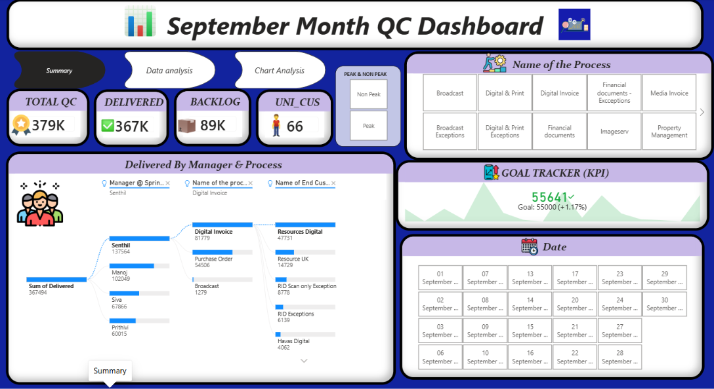

# QC Performance Dashboard (Power BI)

An interactive 3-page Power BI dashboard that tracks quality-check (QC) delivery, backlog and customer performance for one month. Built as a personal practice project.

## Key numbers

| Metric | Value |
|---|---|
| Total QC items | 379K |
| Delivered | 367K (96.8%) |
| Backlog | 89K |
| Unique customers | 66 |

Period covered: [Month Year]

## Dashboard pages

**1. Summary:** headline KPIs, a goal tracker, a manager > process > customer drill-down, and process and date slicers.

**2. Data analysis:** a customer-level table showing delivered %, backlog and a DAX-based performance classification, plus manager averages.

**3. Chart analysis:** deliveries by day, delivered vs. backlog split, a QC tracker, and delivered vs. backlog by customer with Top 5 / Least 5 / Reset buttons.

## What I built

- DAX measures that classify delivery performance and backlog severity
- Top 5 / Least 5 customer ranking using bookmarks and buttons
- A manager > process > customer drill-down visual
- Page navigation buttons and slicers for process, date and peak / non-peak

## Findings

- 96.8% of QC items were delivered (367K of 379K)
- The top 3 customers account for about 39% of all deliveries
- Two of the four managers account for about 65% of deliveries
- Day 3 delivered 36K items, against a typical 13K to 22K on other days

## Tools

Power BI Desktop, DAX

## Files

- `QC Dashboard.pbix`: the Power BI file (open in Power BI Desktop)
- `QC Project.pdf`: PDF export of all three pages
- `Summary.png`, `Data analysis.png`, `Chart analysis.png`: page screenshots

## Author

Roshan Jeyakumar | [LinkedIn](https://www.linkedin.com/in/[your-handle])
